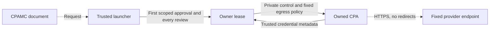

# Hermes CPA Native Plugin

Unified agent plugin for native CLIProxyAPI (CPA) lifecycle supervision, a registered Hermes inference provider, and the full pinned CPA Management Center (CPAMC 1.25.6) in the Agent Dashboard and optional Desktop workspace.

## Features
- Managed CPA child supervision with private Unix domain socket and lifetime advisory lock.
- Clean parent-death termination (`PR_SET_PDEATHSIG`) ensuring no unmanaged orphans.
- Opaque sandboxed CPAMC presentation, with authenticated host mediation and explicit trusted unlock.
- Full pinned configuration, provider-key, OAuth, credential, quota and native-plugin interfaces.
- Revision-checked configuration mutations, reviewed effects and operation reconciliation without mutation replay.
- Separate, short-lived native resource grants tied to the reviewed plugin incarnation and presenting document.

This private working snapshot is accepted for the documented patched Hermes
integration, not for stock Hermes or a generally certified Desktop release.
Rollback can fail or stop on drift/revocation; it never guarantees restoration.
See [native recovery](RECOVERY.md) for observed doctor, lost-owner bootstrap and
explicit snapshot recovery commands, supported boundaries and remaining gaps.

## Native package loading

Directory installs use the root `__init__.py` and Hermes's profile-scoped
`hermes_plugins` namespace. The wrapper extends only its own package search
path; it does not change `sys.path` or alias the wheel's global `hermes_cpa`.
Internal modules use relative imports so two directory installations keep
separate state. Wheel installs expose `hermes_cpa:register` through the standard
`hermes_agent.plugins` entry-point group. The manifest's `entry_point` alone
was not a directory-loader entrypoint.

Registration is inert by default: an external/unconfigured installation starts
no owner, binary, management probe or credential resolution. Explicit
`hermes cpa setup --consent` prepares the checksum-pinned `hermes-owner-v1` CPA
runtime, generates one user-managed public API key, leaves public management
disabled, and starts the exact-owned instance and broker. It enrolls `custom:cpa`
without changing the default model. Managed control and inference use private
Unix channels, not public CPA keys. Setup remembers managed autostart unless
`--no-autostart` is selected. Subsequent opted-in loads acquire scoped service
leases; unloading one host releases only its lease. Explicit stop, plugin disable,
removal or relevant policy revocation stops the owned services. Unrelated Hermes
settings do not stop them. External or unowned CPA is never adopted or stopped.

Directory installs include the desktop and console resources. Python wheels do
not; managed setup refuses an incomplete package. The scoped host patch runs
native CLI argument parsing and handlers in the isolated plugin child, including
normal help and foreground signal handling. Stock Hermes lacks this contract.
See the [repository installation guide](../README.md) for the pinned host patch.
The private snapshot accepts patched Hermes 0.21.6; a minimum generally supported
Desktop version remains unset. The console requires `plugins.isolation: host`.

## Credentials and console authority

The managed instance's public API keys, upstream provider keys and OAuth account
files are user-managed CPA configuration. An explicitly unlocked CPAMC document
can read and edit those values. The console is therefore a privileged credential
editor, not a secret-redacted status view. It never receives the Hermes session
token, private owner authority or broker signing authority.

The trusted launcher binds operations to its captured host/profile session and
console document. Mutations require review through the trusted host UI; accepted
operations are polled by receipt rather than replayed after an uncertain reply.
Locking, selection retirement and plugin-generation changes revoke the document.
Desktop external links use the native opener; Dashboard links require a new user
gesture on the trusted launcher prompt. File import and export are bounded at
10 MiB and 32 MiB respectively.

Conflicting management requests are queued through their terminal receipts before
the next review is prepared. Known read-only management routes still overlap;
arbitrary plugin handlers do not. Pending receipts use short, growing poll waits,
without resubmitting accepted operations.

The first matching Codex, Claude or Antigravity quota/profile read asks for one
account-scoped approval until Lock or session expiry. Matching follow-up reads
keep their own owner reviews, host grants and receipts but need no further modal.
The owner verifies the credential against native inventory and accepts only fixed
methods, URLs, headers, queries and bodies. Redirects are refused. Unknown request
shapes, other credentials, arbitrary network calls, inference, resets, credit
consumption, credential changes and plugin actions retain their ordinary prompts.
Managed credential changes and changed account identity invalidate remembered
approval. Normal token refresh for the same account does not expand its scope.

### Session approval security

OAuth/provider credentials and account data are confidential. Hermes session
tokens and private owner/broker authority remain restricted to the host. Explicit
unlock is retained because the console is a credential editor; Lock, expiry,
selection retirement and policy/generation changes revoke its authority.

| Component | Threat | Control | Status |
| --- | --- | --- | --- |
| CPAMC document | Spoofed quota request inherits network consent | Owner matches fixed templates and verifies credential/provider/account identity | Mitigated |
| Trusted launcher | A one-request prompt conceals broader consent | The first prompt explicitly names the account and permission lifetime | Mitigated |
| Owner lease | A prepared no-modal review survives credential replacement | Credential version is checked during preparation, acceptance and dispatch; grants retain that version | Mitigated |
| CPA egress | A redirect discloses a substituted credential | Fixed HTTPS destination and method; no redirects, Host overrides or explicit proxies | Mitigated |
| Policy sampler | Cached YAML hides a disable or replacement | Identity/epoch checks still run before and after reuse; recent or future-dated stamps reparse | Mitigated |
| Provider | Repeated approved reads exhaust provider limits | Existing request bounds and lease expiry remain; provider errors are not replayed | Accepted |

These controls assume the patched host and native CPA binary are trusted. Native
plugin code and a compromised local account are outside the sandbox's protection.
Recheck this model when templates, credential identity or approval lifetime change.

Native plugin pages use a separate resource grant, not the console management
channel. A grant authorizes an exact resource for the reviewed plugin incarnation;
native GETs may have effects and are not automatically retried. Resource content
does not inherit Hermes headers, cookies, session tokens or the console bridge.

Managed private channels remain independent of public CPA host, port, TLS,
management-secret and API-key settings. Public credential changes therefore do
not require re-enrolling Hermes. Models are discovered through the broker using
Hermes's normal cache; use Refresh Models for immediate discovery.

External-instance passive reads still resolve `HERMES_CPA_MANAGEMENT_KEY` from the
authenticated request's pinned profile, never another profile or ambient fallback.
The explicit standalone external broker separately uses that owner's
`HERMES_CPA_INFERENCE_KEY`; it is not the managed owner channel. See
[subscription broker](SUBSCRIPTION-BROKER.md).

Existing configurations or legacy private CPA key entries are not silently
migrated, rotated, reused or deleted by setup. Private-channel transitions need an
explicit migration plan and credential backup. Generated qualification does not
imply live credential migration or real provider authorization.
